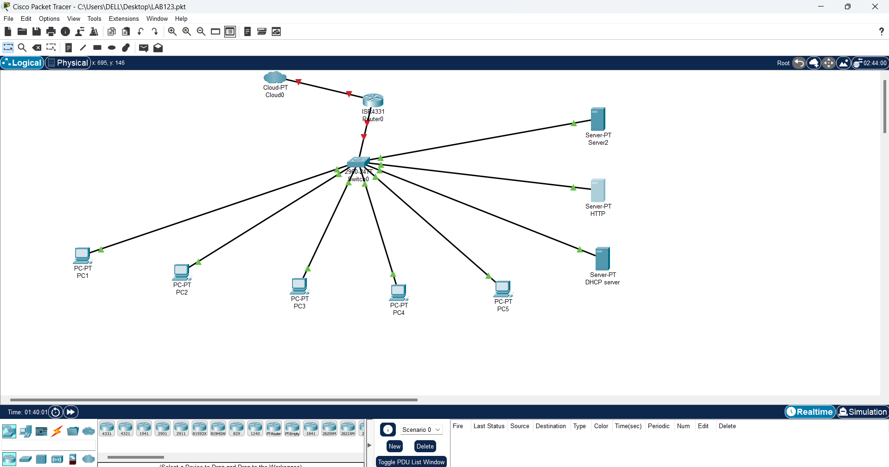
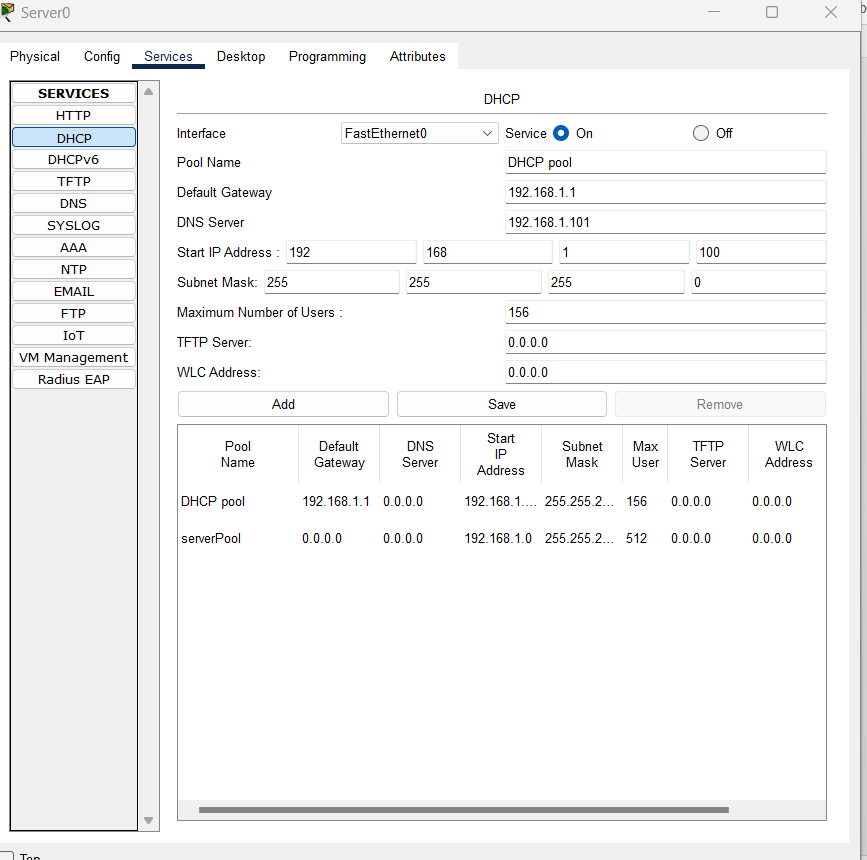

# Lab 01 · Small Office Network

A star-topology LAN where every device connects to a central switch, with a router as the default gateway and dedicated servers for core services.

## What I configured

- Router interface `G0/0` as the default gateway (`192.168.1.1/24`)
- Static IP addresses on the PCs
- **DHCP server** with an address pool starting at `192.168.1.100`
- **DNS server** so clients can reach the web server by name
- **HTTP server** hosting a simple web page
- **Email server**, tested by sending mail between two clients

| Device | Interface | IP address | Gateway |
|---|---|---|---|
| Router | G0/0 | 192.168.1.1 | — |
| PC1 | Fa0/3 | 192.168.1.2 | 192.168.1.1 |
| PC2 | Fa0/4 | 192.168.1.3 | 192.168.1.1 |
| PC3 | Fa0/5 | 192.168.1.4 | 192.168.1.1 |
| PC4 | Fa0/2 | 192.168.1.5 | 192.168.1.1 |
| PC5 | Fa0/6 | 192.168.1.6 | 192.168.1.1 |

File: [`small-office-network.pkt`](small-office-network.pkt)
