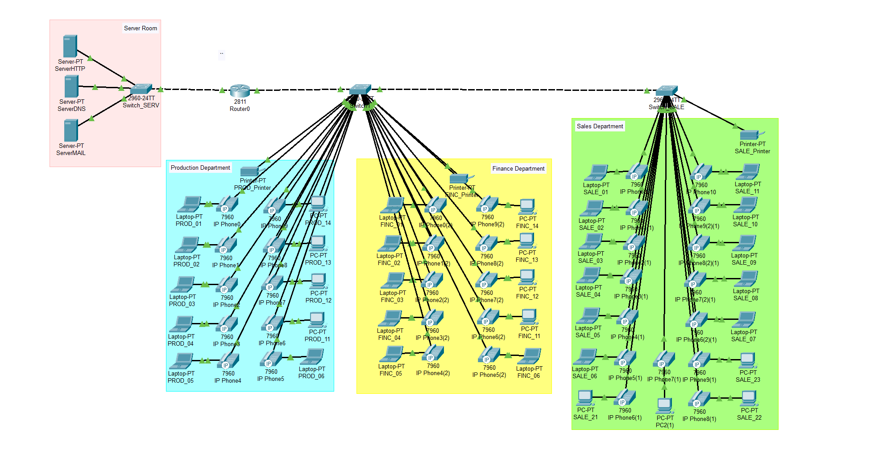

# Lab 02 · Branch Network with VLANs and VoIP

Network for a new company branch with three departments (Production, Sales, Finance), a server room and IP desk phones. The `192.168.10.0/24` network is split into subnets, one VLAN per department.



> Group project: I worked on this design with classmates.

## Addressing plan

| Department | VLAN | Network | Mask | Gateway |
|---|---|---|---|---|
| Server room | 10 | 192.168.10.0/27 | 255.255.255.224 | 192.168.10.1 |
| Production | 20 | 192.168.10.32/27 | 255.255.255.224 | 192.168.10.33 |
| Sales | 30 | 192.168.10.64/27 | 255.255.255.224 | 192.168.10.65 |
| Finance | 40 | 192.168.10.96/27 | 255.255.255.224 | 192.168.10.97 |
| IP phones (voice) | 50 | 192.168.10.128/26 | 255.255.255.192 | 192.168.10.129 |

## Key configuration

**Inter-VLAN routing (router-on-a-stick)**
```
interface FastEthernet0/0.20
 encapsulation dot1Q 20
 ip address 192.168.10.33 255.255.255.224
```

**DHCP pool per VLAN**
```
ip dhcp pool PROD
 network 192.168.10.32 255.255.255.224
 default-router 192.168.10.33
```

**Access, voice and trunk ports on the switches**
```
interface range fa0/1-11
 switchport mode access
 switchport access vlan 20
 switchport voice vlan 50
interface gig0/1
 switchport mode trunk
```

**IP telephony (Cisco CME)**
```
telephony-service
 max-ephones 35
 max-dn 35
 ip source-address 192.168.10.129 port 2000
 auto assign 1 to 5
ephone-dn 1
 number 12001
```

File: [`vlan-voip-branch-network.pkt`](vlan-voip-branch-network.pkt)
