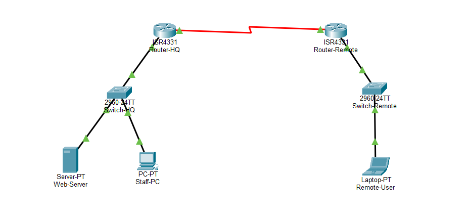
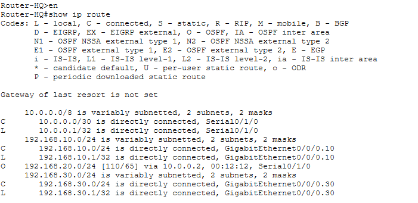
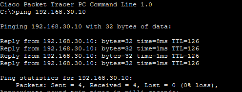

# Lab 03 · Multi-Site Network with OSPF

Network for a ~50-person company with a head office (HQ) and a remote branch, linked by a serial WAN connection. **OSPF** shares routes between the two sites automatically.

## Design

- **HQ:** Cisco ISR4331 router, 2960 switch, web server and staff PC
- **Remote branch:** ISR4331 router, 2960 switch and remote user laptop
- **WAN link:** serial point-to-point link on `10.0.0.0/30`
- **Routing:** OSPF instead of RIP, for faster convergence and better scalability as the company grows

## Verification

The HQ routing table shows the remote network learned through OSPF (`O` entry):

A ping from the remote user to the HQ web server succeeds:

File: [`multi-site-ospf-network.pkt`](multi-site-ospf-network.pkt)
